# Le rail suit-il la France qui grandit ?

**Rapport d'analyse descriptive — version du 26 octobre 2026**

## Résultats principaux et champ de validité

Les données rapprochent population et fréquentation des gares sur 2016–2022, avec une mise en perspective ferroviaire 2015–2024. Sur **2 618 communes comparables**, les taux annuels de croissance sont faiblement associés : **Pearson=0,111** et **Spearman=0,114**. **484 communes** combinent une population strictement croissante et des comptages en gare décroissants.

Ce résultat concerne les communes d'implantation d'une cohorte de gares observées, qui représentent **46,76% de la population métropolitaine 2022**. Il ne mesure pas un retard de l'offre ferroviaire ni un déficit de capacité, et ne s'extrapole pas à toutes les communes. Une gare reçoit aussi des habitants des communes voisines, des visiteurs et des correspondances.

## 1. Une base réelle et contrôlée

La base démographique comprend **34 858 communes** dans le COG 2025, avec des populations historiques 1968–2022, des ménages et des modes domicile–travail. La table ferroviaire compte **3 021 UIC ×10 années=30 210 observations** ;3 019 UIC sont rattachés à une commune. Le SDES apporte un stock de voitures harmonisé par codes sur 34 854 communes ; l'avion et les scénarios démographiques restent dans des tables séparées de grain adapté.

Le bilan de validation est **72 contrôles réussis sur 72**, avec **176 fichiers bruts vérifiés par empreinte**. Cette validation établit la cohérence des traitements et des instantanés, sans garantir que toutes les mesures publiées sont exemptes d'erreurs. La méthodologie complète, les manifestes et le dictionnaire permettent de retrouver chaque choix.

## 2. Des trajectoires démographiques contrastées

La population métropolitaine passe de son niveau 2016 à **65 846 255 habitants en 2022**, soit une hausse d'environ2,14%. Cette croissance agrégée coexiste avec de nombreuses communes en déclin ; un nombre de communes et un nombre d'habitants ne décrivent pas la même distribution.

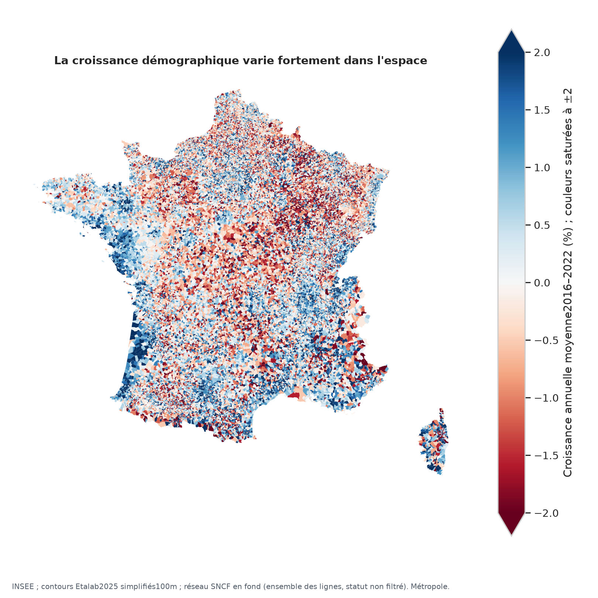

La carte situe les croissances et déclins, sans réduire une région à une seule trajectoire. Les couleurs sont saturées à±2% annuels. Le réseau SNCF est un fond de contexte, sans filtre de service voyageurs et sans mesure de fréquence des trains.

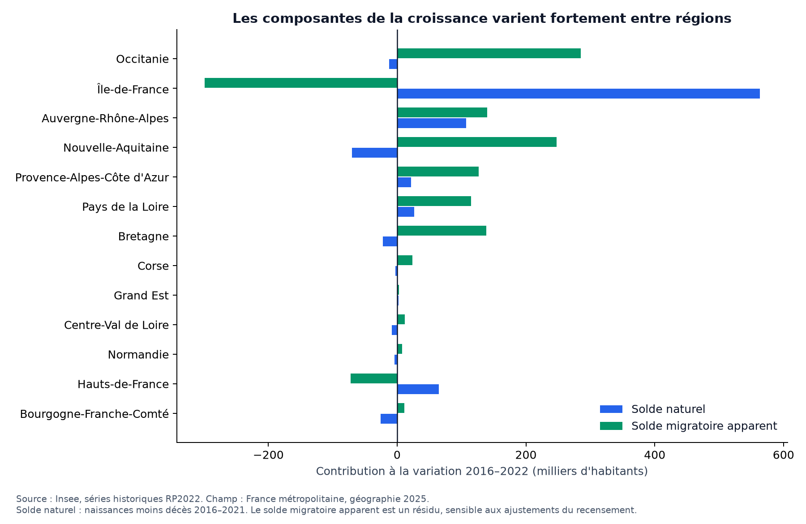

Le solde migratoire apparent est la variation de population diminuée du solde naturel. Les barres décrivent une décomposition comptable ; elles ne constituent pas une mesure pure des seuls flux migratoires observés.

## 3. Une fréquentation concentrée et marquée par le Covid

Les comptages de 2020 représentent **52,28%** du niveau 2019. En 2024, ils atteignent **112,27%** de ce niveau dans le fichier publié, soit une hausse de **12,27%**. La courbe à cohorte complète permet de contrôler l'influence des valeurs observées sur toute la période.

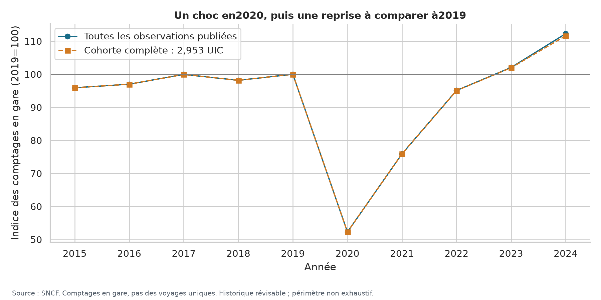

Ces niveaux sont des comptages de gares issus notamment de la billetterie et d'extrapolations en Île-de-France ; ils ne sont pas des voyages uniques. Le producteur signale des révisions historiques et l'absence des billets vendus par des tiers.

Les **303 gares** du décile supérieur concentrent **84,58%** des comptages 2024 ; le Gini entre gares vaut **0,894**. La moyenne seule serait donc peu représentative d'une gare ordinaire.

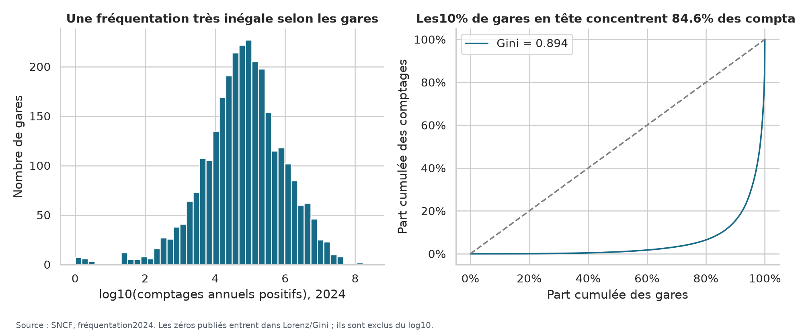

Le Gini décrit une concentration entre équipements, et non l'inégalité d'accès au train entre personnes. Les zéros publiés sont inclus dans ce calcul mais exclus de l'histogramme logarithmique.

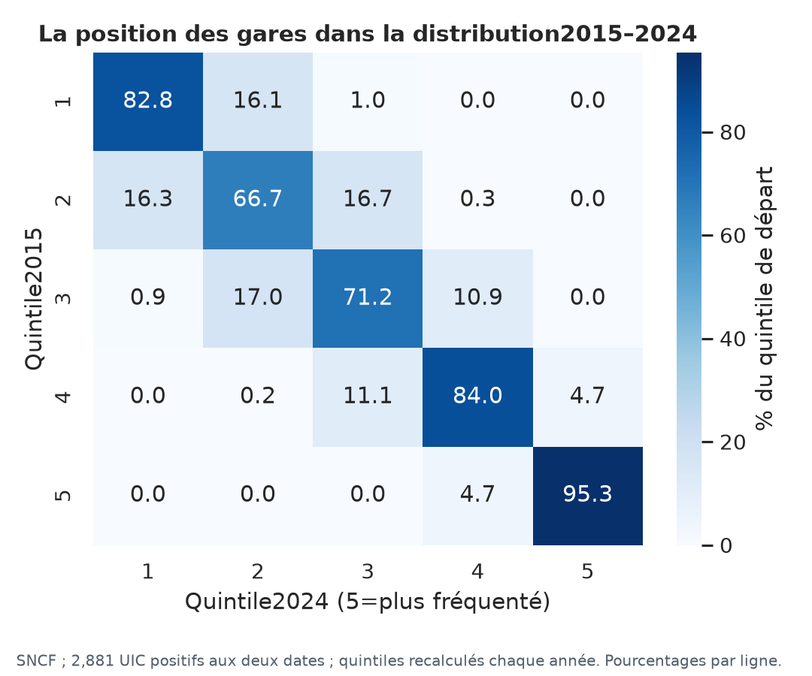

Les quintiles sont recalculés séparément aux deux dates2015et 2024 : une gare peut augmenter ses comptages et perdre du rang si d'autres progressent davantage. Le tableau ne mesure pas directement des fermetures, ouvertures ou variations d'offre.

## 4. Population et rail : une association faible à l'échelle communale

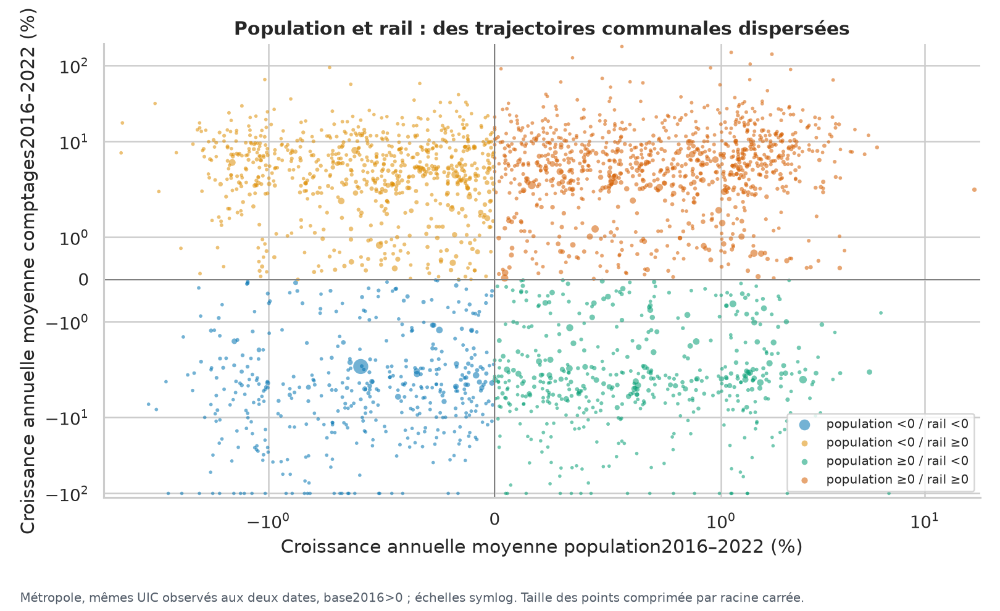

Le nuage présente de fortes différences de trajectoires ferroviaires pour des croissances démographiques proches. Les taux négatifs extrêmes et les petits volumes de départ motivent les vérifications de sensibilité, sans suppression automatique des observations.

| Signes des TCAM | Communes | Part des communes (%) |
| --- | --- | --- |
| population <0 / rail <0 | 437 | 16,69 |
| population <0 / rail ≥0 | 727 | 27,77 |
| population ≥0 / rail <0 | 486 | 18,56 |
| population ≥0 / rail ≥0 | 968 | 36,97 |

La catégorie≥0 inclut la stabilité exacte. Le nombre **484** cité au début exige une hausse démographique strictement positive ; il peut donc être légèrement inférieur au nombre du profil≥0/rail<0 du tableau.

| Champ | Communes | Pearson | Spearman |
| --- | --- | --- | --- |
| communes avec cohorte | 2 618 | 0,111 | 0,114 |
| hors Île-de-France | 2 345 | 0,120 | 0,157 |
| comptages 2016 au moins10000 | 1 909 | 0,119 | 0,087 |
| hors1% des comptages 2022 les plus élevés | 2 591 | 0,112 | 0,116 |
| incluant les alertes géographiques INSEE | 2 623 | 0,111 | 0,114 |

La faible association persiste dans ces variantes, avec une intensité différente. Cela ne démontre ni que la démographie serait sans effet sur la demande, ni que le rail répondrait adéquatement aux besoins : les bassins de gare et les facteurs d'offre ne sont pas identifiés.

## 5. Densité territoriale et dépendance automobile

| Grille INSEE | Communes de la classe | Communes mobilité | Part voiture (%) |
| --- | --- | --- | --- |
| Rural | 30 540 | 30 525 | 86,18 |
| Urbain dense | 692 | 692 | 47,26 |
| Urbain intermédiaire | 3 514 | 3 514 | 78,74 |

La part voiture est nettement plus élevée dans le rural que dans l'urbain dense. Les parts sont des ratios des effectifs agrégés, calculés sur les seules communes aux données comparables ; les actifs sans déplacement restent au dénominateur. La structure urbaine, l'emploi et les transports collectifs autres que le train participent à cette différence.

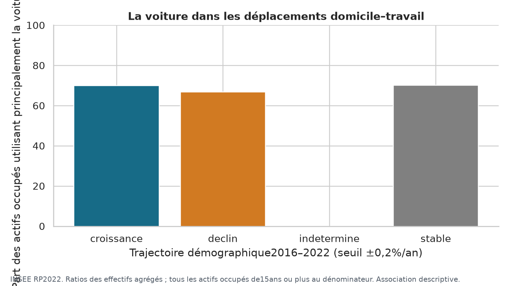

La trajectoire démographique ne suffit pas à expliquer ces parts. Les catégories utilisent un seuil descriptif de±0,2% annuels ; elles ne sont pas des groupes expérimentaux comparables.

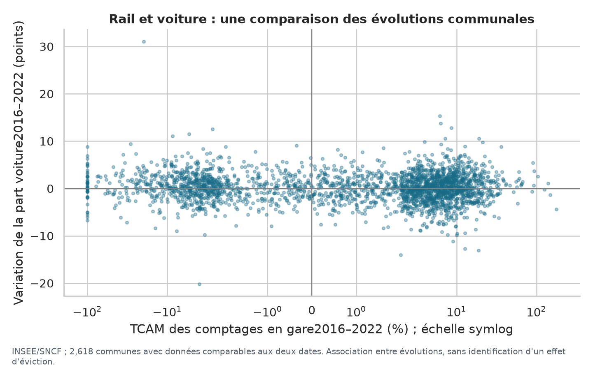

Ce rapprochement porte sur les mêmes années et sur des données de mobilité valides aux deux dates. Il décrit une association entre évolutions communales ; il ne prouve pas un transfert individuel de la voiture vers le train.

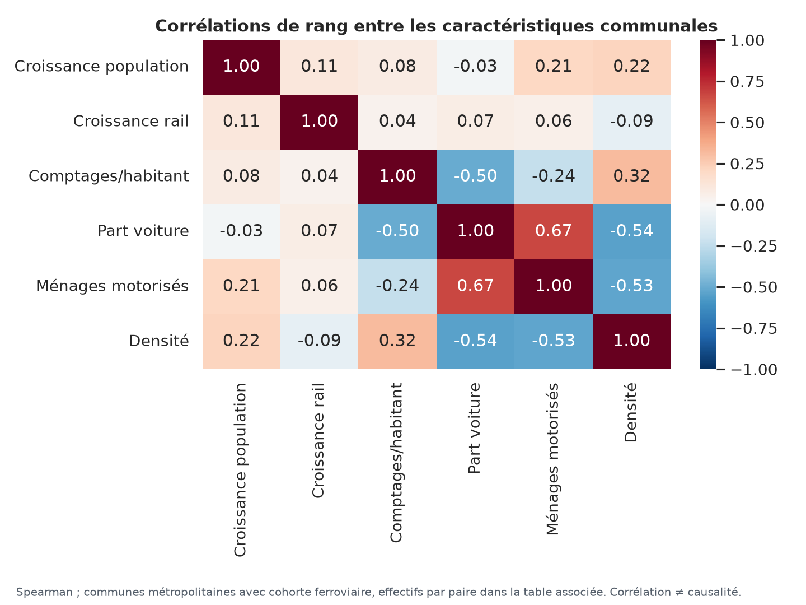

Les coefficients de Spearman résument des relations de rang. Les effectifs par paire sont disponibles dans les tables de sortie ; les relations sont influencées par la densité et la sélection des communes disposant d'une gare observée. Aucun coefficient n'est interprété comme un effet causal.

## 6. Éloignement des gares : un proxy, avec un champ défini

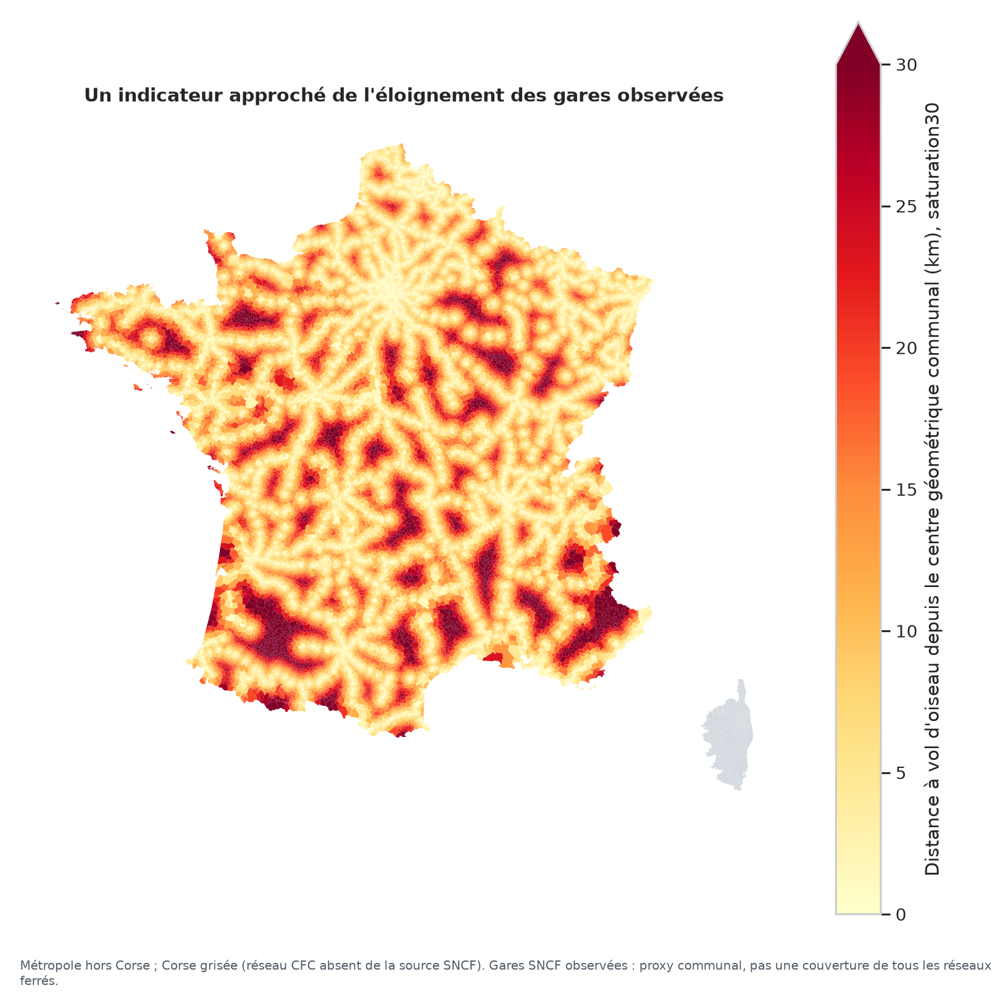

En métropole hors Corse, **9 036 258 habitants** résident dans **13 670 communes dont le centroïde est situé à plus de 10 km d'une gare SNCF observée avec comptage positif en 2024**, soit **13,80%** de la population de ce champ. Cette phrase ne signifie pas que chaque habitant concerné vit lui-même à plus de 10 km d'une gare.

| Seuil (km) | Communes | Population des communes (%) | Hausses positives communales (%) |
| --- | --- | --- | --- |
| 5 | 24 268 | 29,92 | 30,87 |
| 10 | 13 670 | 13,80 | 11,65 |
| 15 | 7 282 | 6,73 | 4,95 |

La sensibilité aux seuils rappelle le caractère conventionnel du classement. La dernière colonne porte sur la somme des hausses communales positives, pas sur la croissance nette. La Corse est grisée pour absence du réseau CFC dans la source ; RATP, Chemins de fer de Provence et autres réseaux hors périmètre empêchent d'assimiler ce proxy à l'accès à tout le rail. Les distances sont à vol d'oiseau et ne mesurent pas les horaires ni les accès routiers.

## 7. Climat : comparer les modes sans inventer des émissions évitées

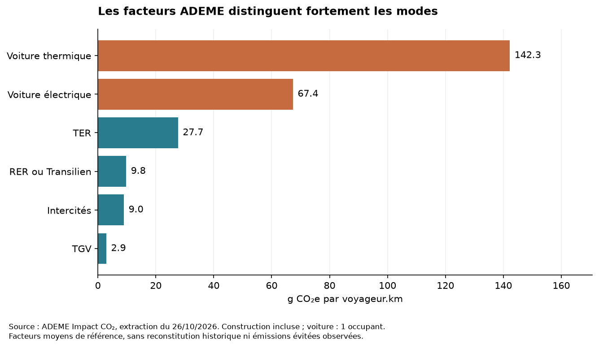

Les facteurs ADEME en CO₂e par voyageur.km diffèrent fortement selon les modes, pour les paramètres publiés et archivés. La voiture est ici à un occupant et la construction est incluse. Ces moyennes ne sont ni des mesures communales ni une reconstitution de facteurs historiques 2016–2022.

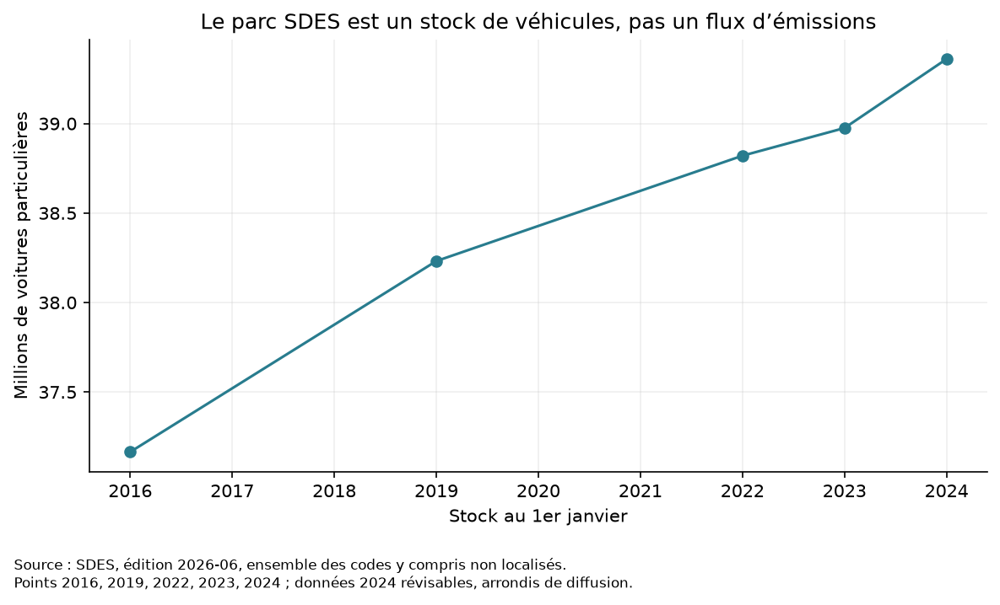

Le SDES décrit un stock, pas les kilomètres ni les émissions sur le territoire. Il n'est pas défendable de multiplier les comptages des gares par une distance moyenne inventée pour produire des « tonnes évitées ». Un bilan climatique territorial exigerait des distances, origines–destinations, parts de report et inventaires d'émissions harmonisés.

## 8. À l'horizon 2050 : des scénarios démographiques, sans prévision de trafic

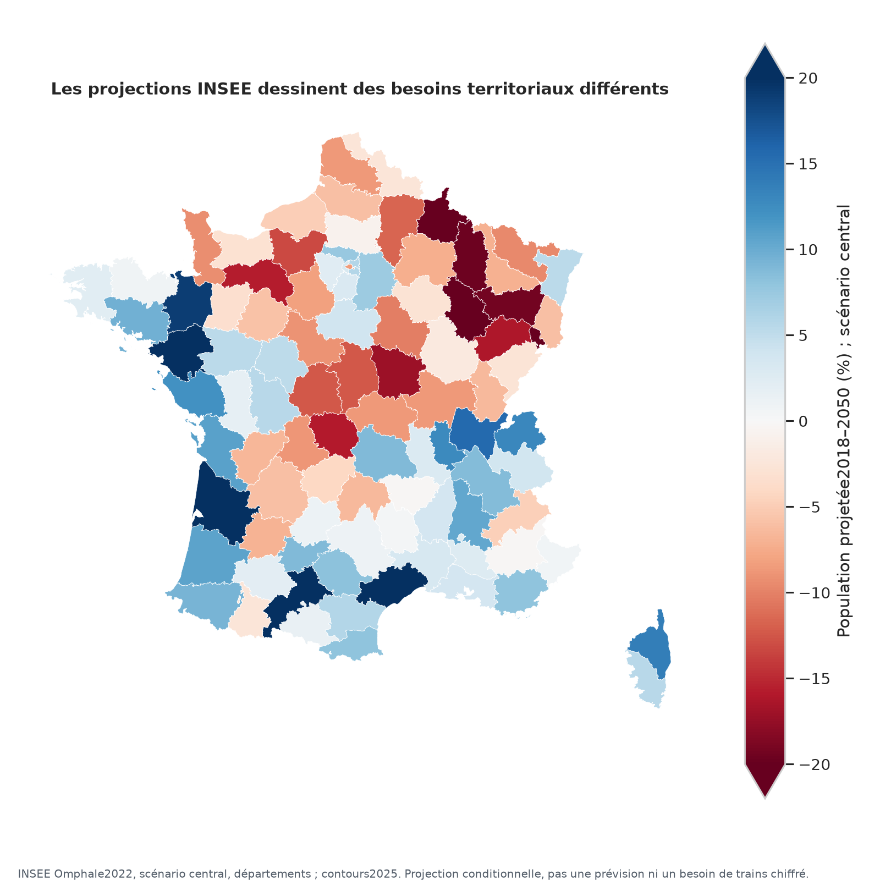

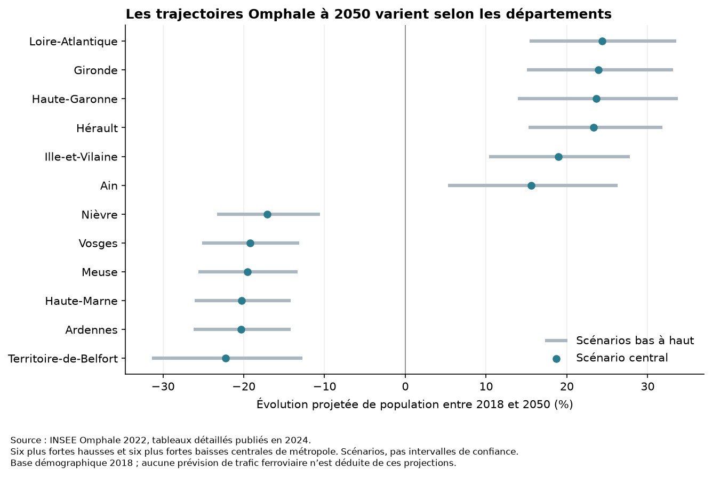

Ces scénarios officiels indiquent où la population pourrait augmenter ou diminuer sous les hypothèses Omphale. Les différences entre scénarios ne constituent pas des intervalles de confiance. Aucune demande ferroviaire future n'est calculée à partir d'une corrélation communale faible.

## 9. Complément aérien : reprise différente et données de liaisons censurées

Le trafic intérieur métropolitain DGAC passe de **26 753 422 passagers en 2019** à **20 160 921 en 2024**, soit **-24,64%**. Cette évolution et la reprise des comptages en gare décrivent deux séries d'unités différentes ; elles ne quantifient pas un report avion–train.

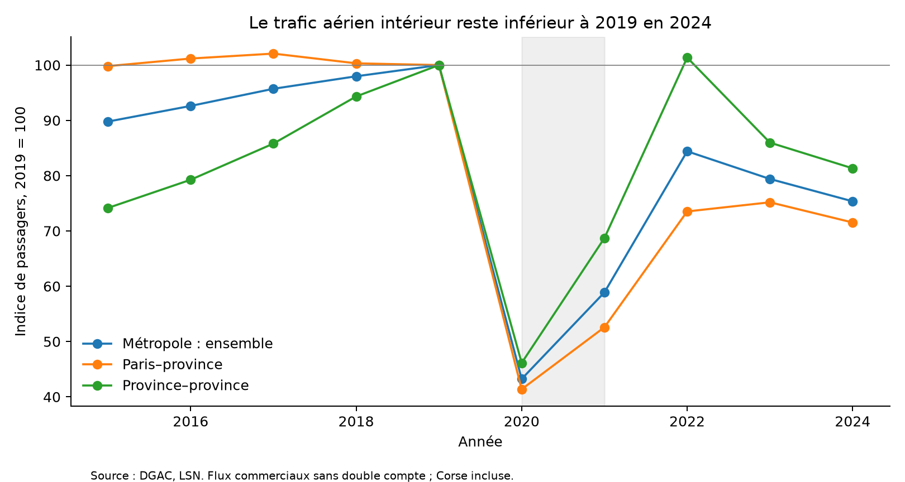

Les liaisons PAP sont masquées sous certaines conditions de secret statistique et de seuil. Les absences ne sont pas remplies par zéro et les deux sens ne sont pas doublés. Le contrôle de couverture documente pourquoi la série nationale agrégée LSN est utilisée pour la tendance d'ensemble.

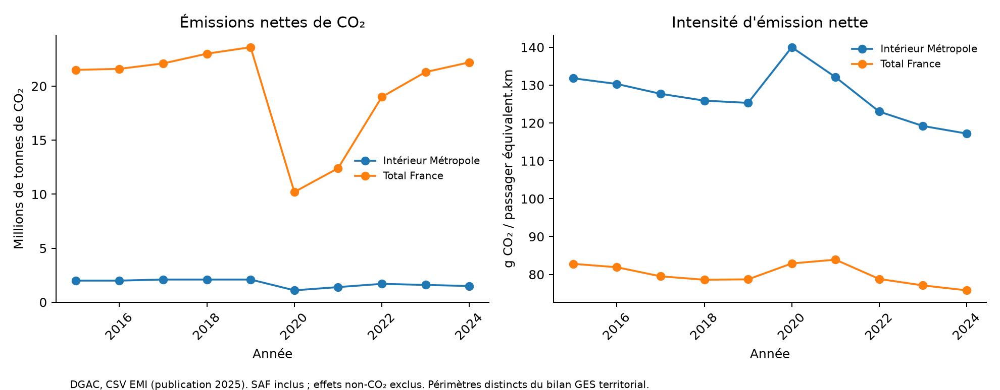

Le CSV DGAC affiche22,2 Mt de CO₂ pour le total France 2024 contre 22,1 Mt sur une page ministérielle ; l'écart est signalé, sans correction forcée. Le périmètre aérien et le CO₂ ne sont pas assimilés aux facteurs ADEME de CO₂e. Les évolutions observées ne permettent pas d'identifier l'effet du seul décret 2023-385 ; la prolongation après mai 2026 n'a pas été établie par les sources primaires consultées.

## 10. Ce que permet le projet, et ses limites

Le projet met en évidence une fréquentation concentrée, une reprise après le Covid, une faible association communale rail/population et une dépendance automobile fortement liée à la densité. Il localise un éloignement approché des seules gares du périmètre SNCF étudié et présente des scénarios démographiques officiels.

Il ne mesure pas l'adéquation de l'offre, l'accès individuel à tous les réseaux, un effet causal de report modal ou un volume réel d'émissions évitées. Pour ces questions, les prolongements utiles seraient des bassins de desserte, une population carroyée, des temps d'accès, des horaires historiques, des flux origine–destination et une stratégie d'identification causale adaptée.

Les sources primaires, formules, filtres, exceptions et commandes de reproduction figurent dans `METHODOLOGIE.md`. Les tableaux détaillés sont dans `outputs/tables/`, les archives et manifestes dans `data/raw/`, et le notebook exécuté dans `main.ipynb`.
